# Clickstream Analytics: Snowflake + dbt

An end-to-end **ELT pipeline** for e-commerce clickstream data. Raw CSVs are loaded into **Snowflake**, then **dbt** transforms them through a **medallion architecture** (Bronze → Silver → Gold) into analytics-ready marts for conversion, session and product analysis. The pipeline is tested, documented, and secured with key-pair authentication.

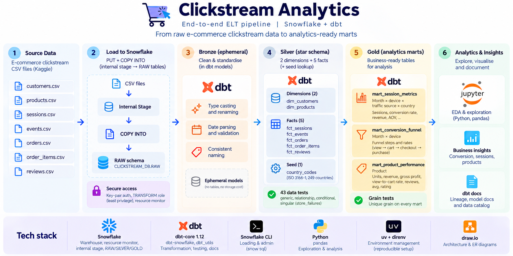


---

## Highlights

- **~1M rows** across 7 source tables, loaded with `PUT` + `COPY INTO` and verified against expected row counts
- **Medallion layers**: ephemeral Bronze (typing, renaming), Silver star schema (2 dims, 5 facts), 3 Gold marts
- **54 dbt nodes, 43 data tests**: generic, relationship, conditional and singular business-rule tests; failures stored in Snowflake
- **Security**: least-privilege role, key-pair-only service user, resource monitor, secrets kept out of git, PII pseudonymized (SHA-256)
- **Reproducible**: setup scripts, pinned dependencies (`requirements.lock`), and idempotent SQL

## Tech stack

| Area | Tool |
|---|---|
| Warehouse | Snowflake (warehouse, resource monitor, internal stage) |
| Transformation | dbt-core 1.12 + dbt-snowflake, dbt_utils |
| Loading / admin | Snowflake CLI (`snow sql` with templating) |
| Exploration | Python, pandas, matplotlib, JupyterLab |
| Environment | uv, direnv, WSL Ubuntu |
| Diagrams | draw.io |

---

## Dataset

Synthetic e-commerce transactions and clickstream data for analytics, from Kaggle: [E-Commerce Transactions + Clickstream](https://www.kaggle.com/datasets/wafaaelhusseini/e-commerce-transactions-clickstream)


| Table | Rows | Description |
|---|---:|---|
| customers | 20,000 | Customer profile (country, age, signup date, opt-in) |
| products | 1,197 | Catalog with price, cost and margin |
| sessions | 120,000 | Web sessions (device, traffic source, country) |
| events | 760,958 | Page views, add-to-cart, checkout, purchase events |
| orders | 33,580 | Orders with discount and totals |
| order_items | 59,163 | Order lines |
| reviews | 10,780 | Product ratings and texts |

The exploration is in [`notebooks/01_eda.ipynb`](notebooks/01_eda.ipynb). It covers data types, keys, nulls, date ranges and the data quality issues that drove the Bronze and Silver design.

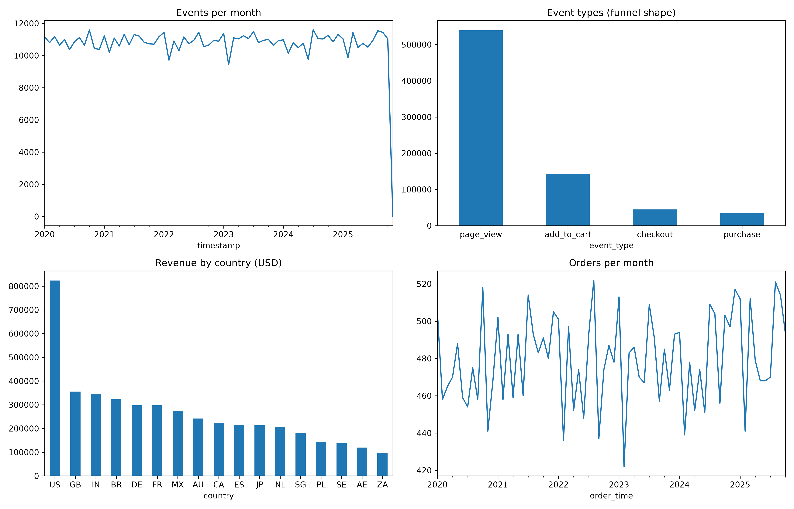

---

## Architecture

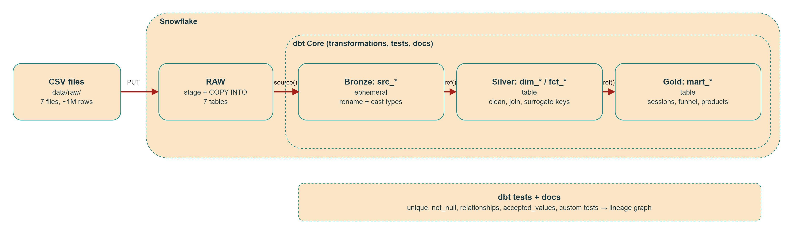

| Layer | Location | Materialization | Purpose |
|---|---|---|---|
| **RAW** | `CLICKSTREAM_DB.RAW` | Tables (`COPY INTO`) | Source data as-is; dates kept as text |
| **Bronze** | `models/bronze/src_*` | Ephemeral | Type casting, date parsing, consistent naming |
| **Silver** | `CLICKSTREAM_DB.SILVER` | Tables | Star schema: `dim_*` and `fct_*`, derived columns, seed lookup |
| **Gold** | `CLICKSTREAM_DB.GOLD` | Tables | Business marts at a defined grain |
| **Test failures** | `CLICKSTREAM_DB.TEST_FAILURES` | Tables | Rows returned by failing tests (`store_failures`) |

### Data model (Silver)

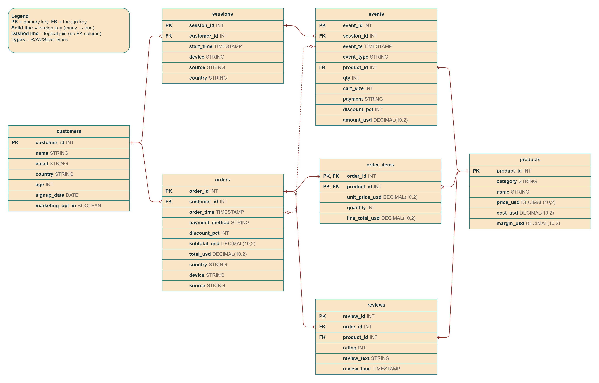

| Model | Grain | Notes |
|---|---|---|
| `dim_customers` | customer | `email_hash` instead of name/email; country name from seed |
| `dim_products` | product | Adds `margin_pct` |
| `fct_sessions` | session | End time, duration, funnel flags (`has_add_to_cart`, `has_checkout`, `has_purchase`) |
| `fct_events` | event | Adds `customer_id` via sessions |
| `fct_orders` | order | `session_id` linked via purchase events; discount, line and item counts |
| `fct_order_items` | order × product | Surrogate key (`dbt_utils`) |
| `fct_reviews` | review | Flags reviews dated before their order |
| `country_codes` (seed) | country | ISO 3166-1 (249 countries) |

### Gold marts

| Mart | Grain | Key metrics |
|---|---|---|
| `mart_session_metrics` | month × device × traffic source × country | Sessions, conversion rate, revenue, revenue per session, AOV, avg. duration |
| `mart_conversion_funnel` | month × device | Viewed → added to cart → checked out → purchased, with step rates |
| `mart_product_performance` | product | Units, revenue, gross profit, view-to-cart rate, reviews, avg. rating |

The incomplete last month is excluded automatically, so trends don't show an artificial drop.


### Example analyses

Ready-to-run business questions in [`dbt/analyses/`](dbt/analyses). Analyses use `ref()` but aren't materialized, so nothing is created in Snowflake.

#### 1. Where do users drop off in the funnel?

```bash
dbt show -s funnel_by_device
```

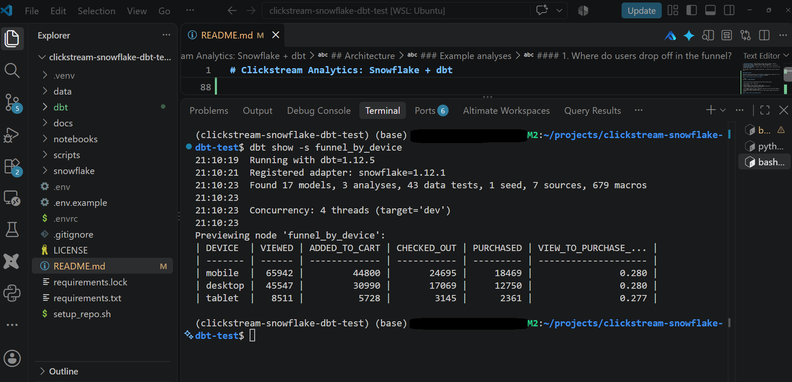

| Step (mobile) | Users | Step rate |
|---|---:|---:|
| Viewed → added to cart | 65,942 → 44,800 | 68% |
| Cart → checkout | 44,800 → 24,695 | **55% (biggest drop-off)** |
| Checkout → purchase | 24,695 → 18,469 | 75% |

- The **biggest drop-off is cart → checkout**: about 45% of users leave after adding to cart, so that's where to optimize first.
- Conversion is almost the same on every device (~28%); mobile simply brings the most traffic.

#### 2. Which traffic source converts best?

```bash
dbt show -s conversion_by_traffic_source --limit 20
```

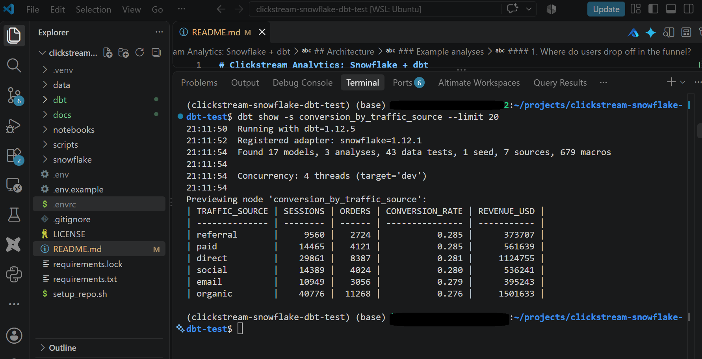

| Insight | |
|---|---|
| Conversion is flat across channels (~28%) | The same pattern as devices |
| **Direct** brings the most sessions and revenue | The largest channel by volume, not by efficiency |

#### 3. Are the most profitable products also the best rated?

```bash
dbt show -s top_products_by_profit --limit 10
```

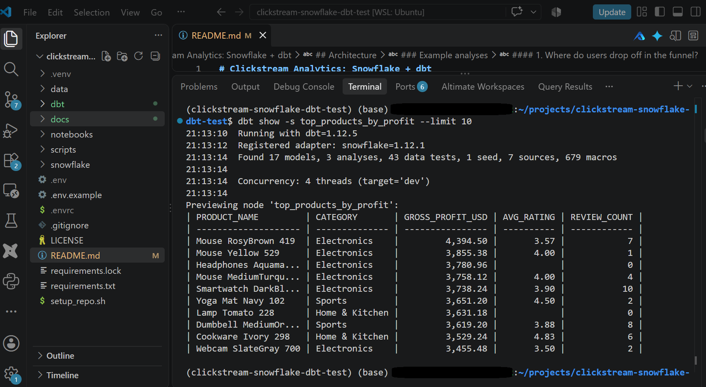

| Category | Products in the top 10 |
|---|---:|
| Electronics | 6 |
| Sports | 2 |
| Home & Kitchen | 2 |

- **Electronics** leads the most profitable products.
- Ratings range from 3.5 to 4.8 and two top products have no reviews, so there's no clear link between rating and profit.

> The flat conversion rates across devices and channels reflect the synthetic dataset.


### Lineage

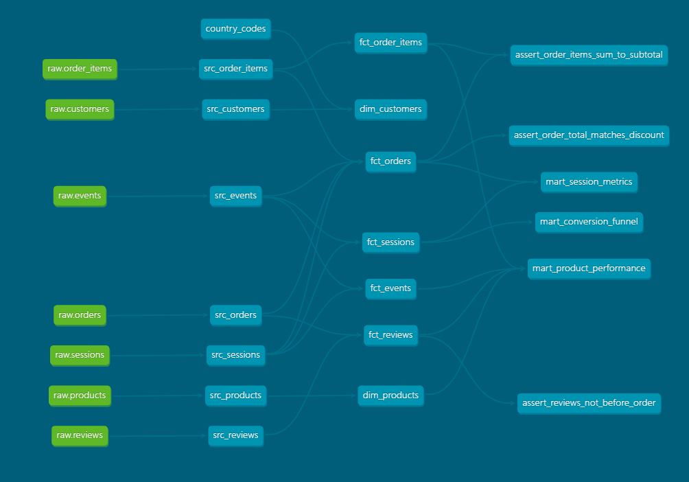

---

## Data quality

| Test type | Examples |
|---|---|
| Primary keys | `unique` + `not_null` on every Silver key |
| Referential integrity | `relationships` between facts and dims, and to the country seed |
| Domain checks | `accepted_values` for `event_type` and `rating` |
| Conditional | `amount_usd` not null **where** `event_type = 'purchase'` |
| Grain | `unique_combination_of_columns` on every Gold mart |
| Business rules (singular) | Order total = subtotal − discount; order items sum to subtotal; reviews not before order (`warn`) |

**Result:** `PASS=53 WARN=1 ERROR=0`. The single warning is intentional: 5,482 reviews are dated before their order. This is a source-data quirk, so the test flags it instead of hiding it, and the rows are stored in `TEST_FAILURES` for inspection.

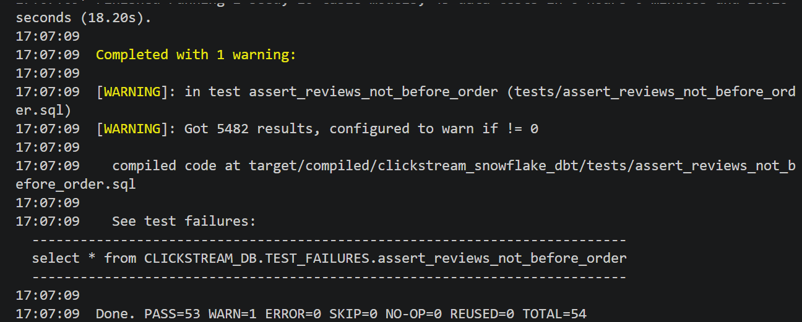

---

## Key design decisions

| Decision | Reason |
|---|---|
| **ELT**: load raw, transform in dbt | RAW stays a faithful copy; all logic is versioned, tested SQL |
| **Ephemeral Bronze** | Cleaning logic without extra tables or storage cost |
| **Seeds only for small lookups** | Country codes as a seed; real data is loaded with `COPY INTO` |
| **Key-pair auth + `TYPE = SERVICE` user** | No password for dbt; the encrypted key lives outside the repo |
| **Least-privilege `TRANSFORM` role** | Reads RAW, writes only to SILVER/GOLD/TEST_FAILURES |
| **Resource monitor (20 credits)** | Cost guard: the warehouse suspends at 90% |
| **PII pseudonymization** | `email_hash` (SHA-256 of the normalized email) keeps a stable join key without exposing emails |
| **Naming conventions** | `_at` for timestamps, `is_`/`has_` for booleans, no ambiguous names like `source` or `name` |
| **No snapshots** | The data is a one-time load; SCD2 only makes sense with incremental loads (see Future work) |

---

## Project structure

```
.
├── data/raw/                  # Kaggle CSVs (git-ignored)
├── dbt/
│   ├── models/
│   │   ├── bronze/            # sources.yml + src_* (ephemeral)
│   │   ├── silver/            # dim_* / fct_* + tests
│   │   └── gold/              # mart_* + tests
│   ├── seeds/                 # country_codes.csv
│   ├── analyses/              # example business questions on the Gold marts
│   ├── tests/                 # singular business-rule tests
│   ├── macros/                # generate_schema_name
│   ├── dbt_project.yml
│   ├── profiles.yml           # reads secrets from environment variables
│   └── packages.yml
├── docs/
│   ├── diagrams/              # draw.io sources
│   └── images/                # screenshots used in this README
├── notebooks/01_eda.ipynb
├── scripts/
│   ├── setup_env.sh           # Python venv + dependencies + Snowflake CLI
│   ├── setup_snowflake_connection.sh
│   └── setup_dbt.sh           # direnv, dbt deps, dbt debug
├── snowflake/
│   ├── 01_generate_keys.sh    # encrypted RSA key pair
│   ├── 02_setup_snowflake.sql # warehouse, DB, schemas, role, user
│   ├── 03_load_raw_data.sql   # stage, PUT, COPY INTO
│   └── 04_check_raw_counts.sql
├── .env.example
├── requirements.txt
└── requirements.lock
```

---

## Usage

### Prerequisites

- Linux, macOS or WSL with `git`, `openssl` and [`uv`](https://docs.astral.sh/uv/)
- A Snowflake account (the free trial is enough) with an `ACCOUNTADMIN` user
- The Kaggle CSVs (see [Dataset](#dataset))

### Steps

**1. Clone the repo**
```bash
git clone https://github.com/haaaaaaash/clickstream-snowflake-dbt.git
cd clickstream-snowflake-dbt
```

**2. Create `.env` from the template and fill it in**
```bash
cp .env.example .env
```
| Variable | Value |
|---|---|
| `SNOWFLAKE_ACCOUNT` | Your account identifier (`ORG-ACCOUNT`) |
| `SNOWFLAKE_USER` | Your admin user (used only for setup) |
| `DBT_PRIVATE_KEY_PASSPHRASE` | A passphrase of your choice for the dbt key (in single quotes) |
| `DBT_PROJECT_DIR`, `DBT_PROFILES_DIR` | Keep `dbt` |

`.env` is git-ignored. Never commit it.

**3. Add the data**

Download the 7 CSVs from Kaggle into `data/raw/`.

**4. Set up Python, dbt and the Snowflake CLI**
```bash
bash scripts/setup_env.sh
source .venv/bin/activate
```

**5. Create the Snowflake CLI admin connection** (the password is typed hidden and never stored in the repo)
```bash
bash scripts/setup_snowflake_connection.sh
```

**6. Generate the key pair for dbt** (stored in `~/.ssh/snowflake/`, outside the repo)
```bash
bash snowflake/01_generate_keys.sh
```

**7. Create the Snowflake infrastructure** (warehouse, database, schemas, role, service user)
```bash
PUB_KEY=$(grep -v "PUBLIC KEY" ~/.ssh/snowflake/rsa_key.pub | tr -d '\n')
snow sql -c admin -f snowflake/02_setup_snowflake.sql -D pub_key="$PUB_KEY"
```

**8. Load the raw data**
```bash
snow sql -c admin -f snowflake/03_load_raw_data.sql -D data_dir="$(pwd)/data/raw"
snow sql -c admin -f snowflake/04_check_raw_counts.sql   # all rows should be OK
```

**9. Set up dbt** (direnv, packages, connection test)
```bash
bash scripts/setup_dbt.sh
```
Open a new terminal afterwards so direnv loads `.env` automatically.

**10. Build and test everything**
```bash
dbt build          # seeds, models and tests → expect ERROR=0, WARN=1
```

**11. Browse the documentation and lineage**
```bash
dbt docs generate
dbt docs serve --no-browser   # open http://localhost:8080
```

**Optional: run the EDA notebook**
```bash
jupyter lab notebooks/01_eda.ipynb
```

### Useful commands

| Command | Purpose |
|---|---|
| `dbt build -s silver` | Build and test one layer |
| `dbt build -s dim_customers+` | Rebuild a model and everything downstream |
| `dbt test -s test_type:singular` | Run only the business-rule tests |
| `dbt show -s mart_conversion_funnel` | Preview a model's output |

### Clean up (optional)

Run as `ACCOUNTADMIN` to remove everything the project created:
```sql
DROP DATABASE IF EXISTS CLICKSTREAM_DB;
DROP WAREHOUSE IF EXISTS TRANSFORM_WH;
DROP USER IF EXISTS DBT_USER;
DROP ROLE IF EXISTS TRANSFORM;
DROP RESOURCE MONITOR IF EXISTS TRANSFORM_MONITOR;
```

---

## Screenshots

<details>
<summary>Snowflake</summary>

**RAW row counts:** all 7 tables match the expected counts from the EDA.

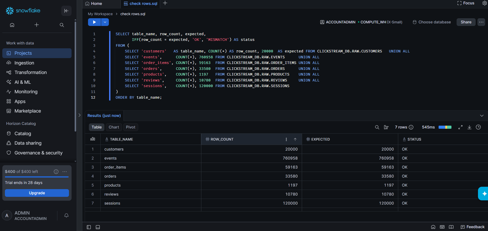

**Schemas:** RAW, SILVER, GOLD and TEST_FAILURES in `CLICKSTREAM_DB`.

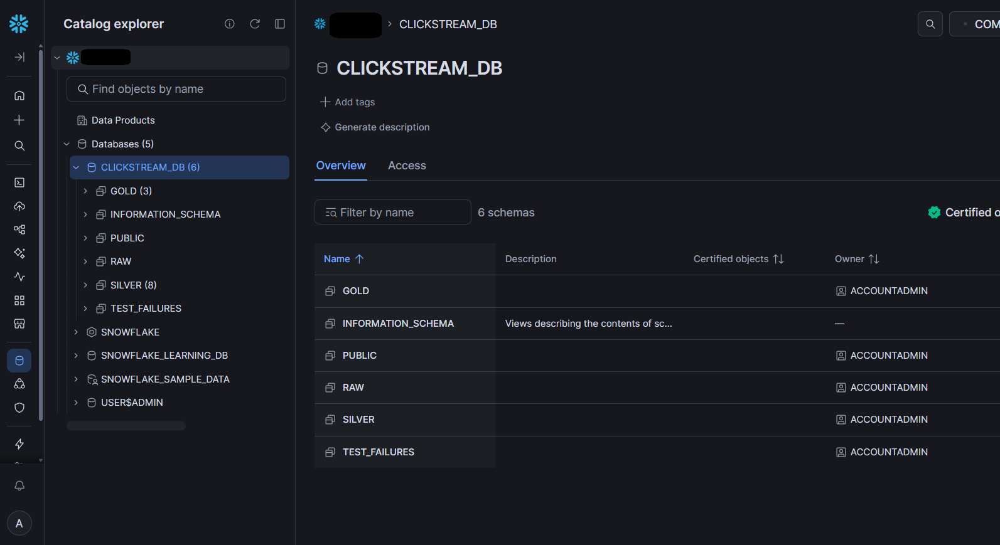

</details>

<details>
<summary>Silver models</summary>

**`dim_customers`:** one row per customer; `email_hash` replaces name and email.

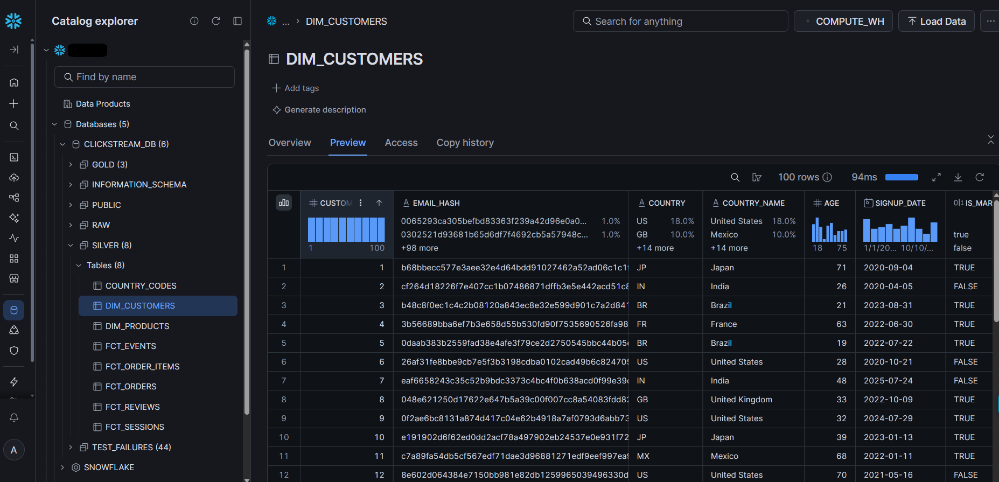

**`dim_products`:** product catalog with derived `margin_pct`.

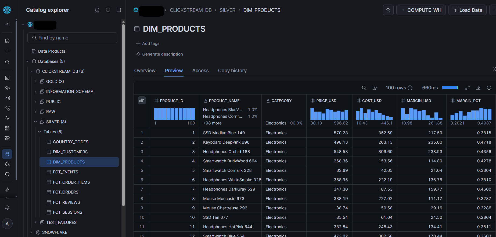

**`fct_events`:** one row per clickstream event, enriched with `customer_id`.

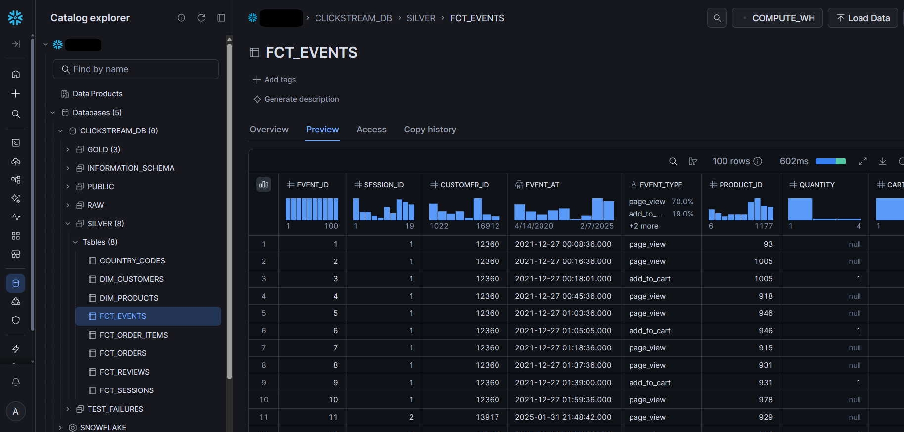

**`fct_sessions`:** one row per session with end time, duration and funnel flags (`has_add_to_cart`, `has_checkout`, `has_purchase`).

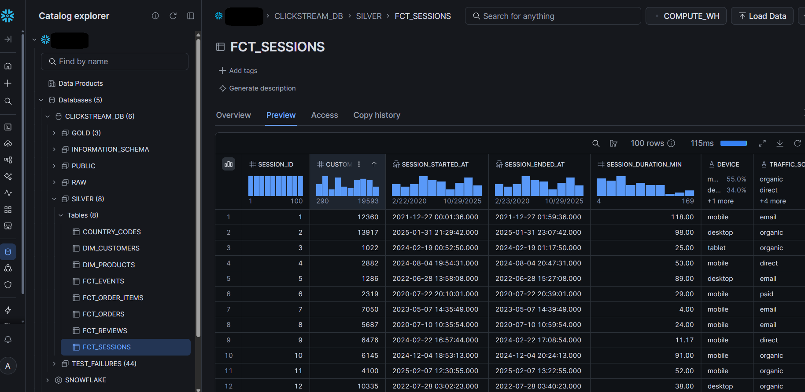

**`fct_orders`:** one row per order, linked to its session via purchase events.

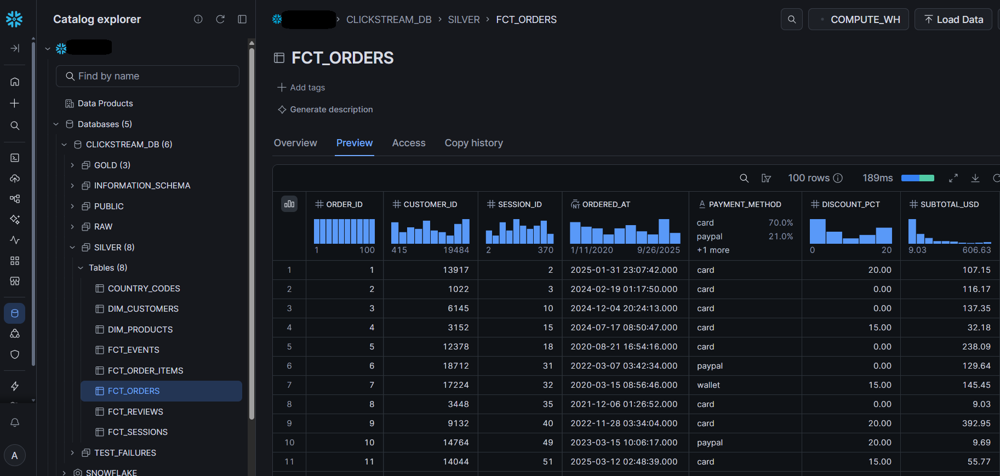

**`fct_order_items`:** one row per order × product, with a surrogate key (`order_item_key`).

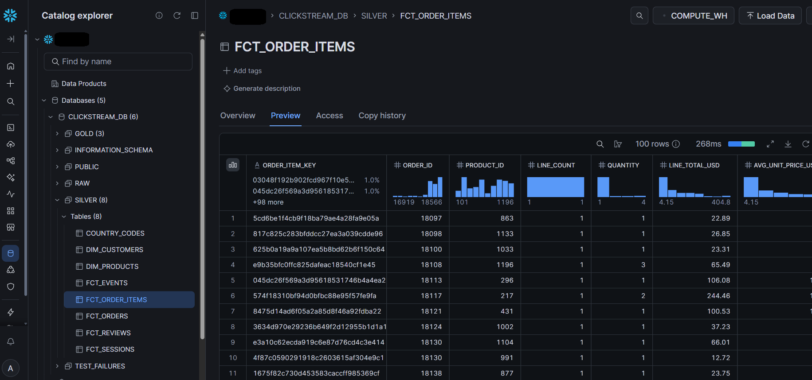

**`fct_reviews`:** one row per review, flagging reviews dated before their order.

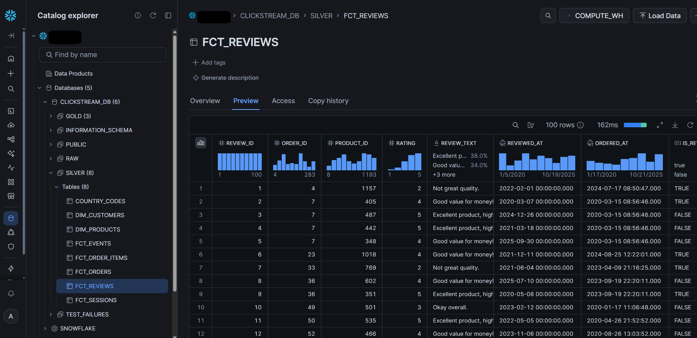

**`country_codes` (seed):** ISO 3166-1 lookup for 249 countries.

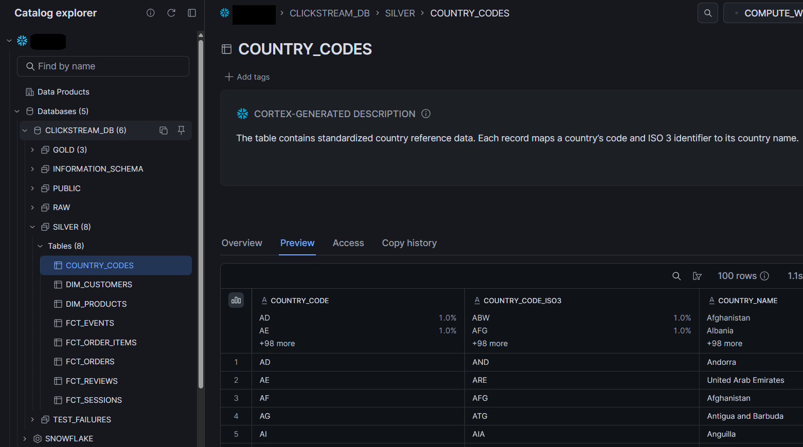

</details>

<details>
<summary>Gold marts</summary>

**`mart_session_metrics`:** sessions, conversion rate, revenue and AOV per month × device × traffic source × country.

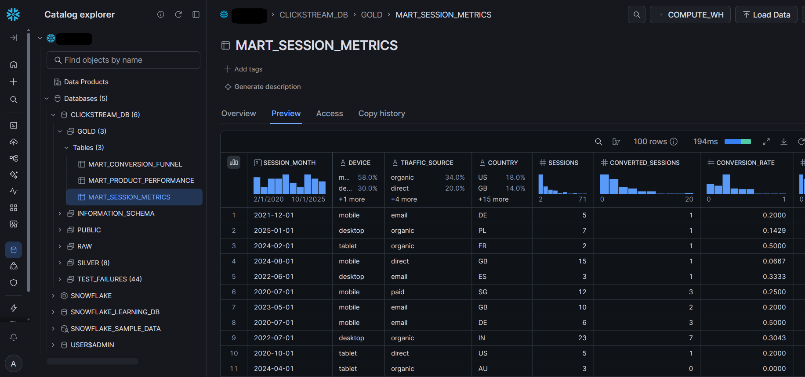

**`mart_conversion_funnel`:** view → cart → checkout → purchase counts and step rates per month × device.

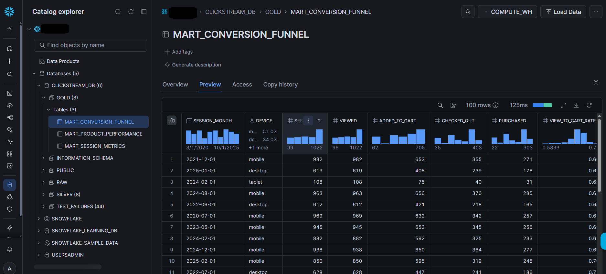

**`mart_product_performance`:** units, revenue, gross profit, view-to-cart rate and ratings per product.

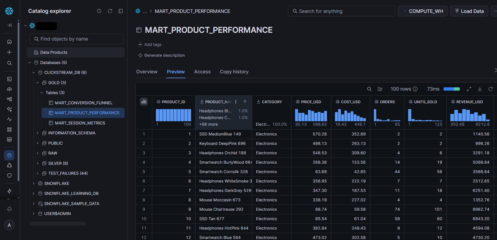

</details>

<details>
<summary>dbt docs and test failures</summary>

**dbt docs:** model page with descriptions, columns and tests.

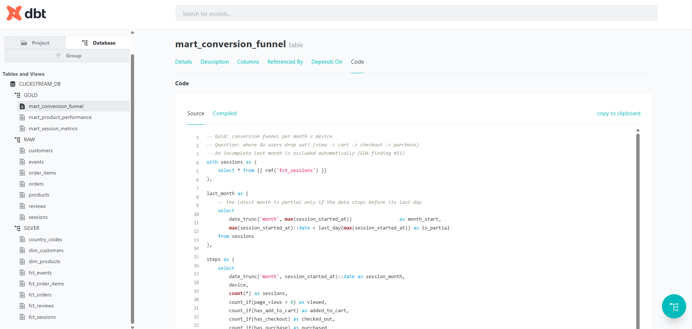

**dbt docs:** model page with descriptions, columns and tests.

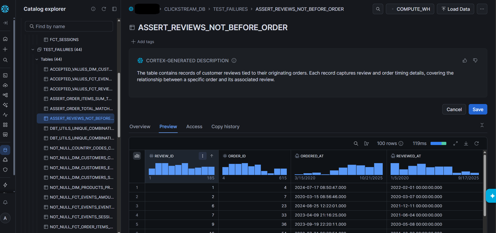

</details>

---

## Lessons learned

Every challenge in this project taught me something. These are the most valuable ones:

| Challenge | Solution / lesson |
|---|---|
| Snowflake CLI and dbt broke each other in the same venv (dependency conflict) | Install CLI tools in isolation with `uv tool install`; keep the project venv for project dependencies only |
| The "exclude partial month" logic also dropped the complete last month | Check the grain and edge cases: compare the last date with `last_day()` before filtering |
| dbt tried to create `_TEST_FAILURES` and failed with "insufficient privileges" | Custom schema names must match the grants exactly; read the dbt logs before changing permissions |
| 5,482 reviews are dated before their order | Don't hide bad source data: a `warn` test flags it, and keeps it visible |
| Raw emails in an analytics model | Pseudonymize PII early (`email_hash`) and keep the join key stable |

## Future work

| Area | Improvement |
|---|---|
| **PII access** | Role-based access via a secure view with `IS_ROLE_IN_SESSION('PII_READER')`, or masking policies (Enterprise); a separate `LOADER` role so the dbt role no longer reads raw PII |
| **History tracking** | dbt snapshots (SCD Type 2), e.g. for product prices, once data arrives incrementally |
| **Incremental models** | Incremental `fct_events` instead of full rebuilds |
| **Orchestration** | Scheduled runs with Airflow |
| **CI/CD** | GitHub Actions running `dbt build` on every pull request against a dev target |
| **Environments** | Separate `dev` / `prod` targets and schemas |
| **Monitoring** | Source freshness checks |
| **BI layer** | A dashboard on top of the Gold marts |
| **Insights notebook** | Charts on the Gold marts (funnel, channels, products) |